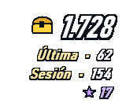
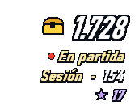
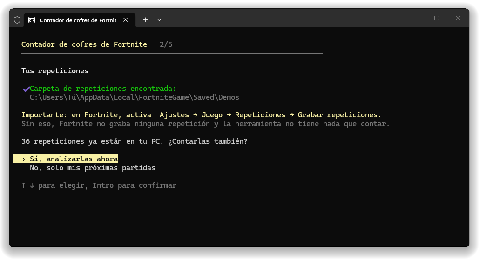
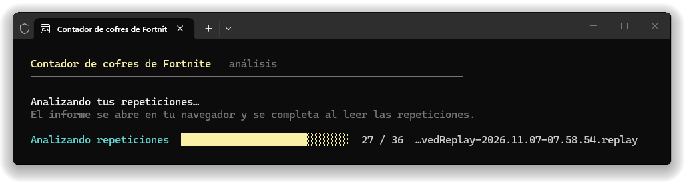
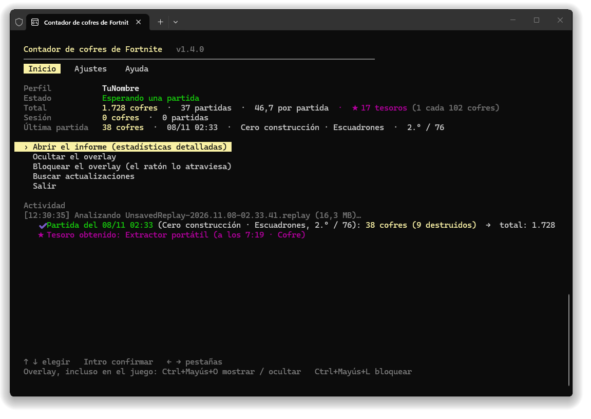
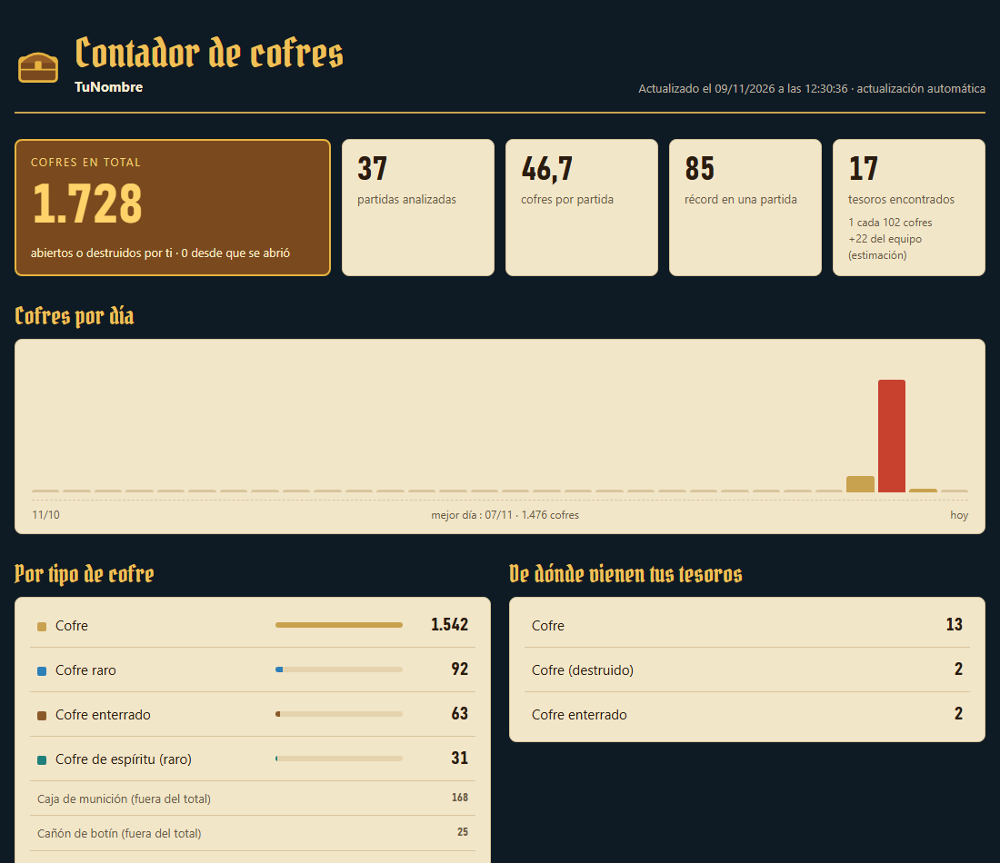

<div align="center">

[English](README.md) · [Français](README.fr.md) · **Español**

# Contador de cofres de Fortnite

[](../../releases/latest) [](../../releases)  [](LICENSE)

**Cuenta cada cofre que abres en Fortnite, partida tras partida, con un overlay en el juego.**

&nbsp;&nbsp;

[**⬇ Descargar ChestCounter.exe**](../../releases/latest) · Windows 10 / 11 · gratis · sin instalación

</div>

---

Chest Counter lee las repeticiones que Fortnite guarda después de cada partida y lleva la cuenta de los cofres que has abierto, además de los **tesoros de la búsqueda del tesoro** que te han dado tus cofres. Un overlay siempre visible muestra tus totales mientras juegas, y un informe detallado guarda todo tu historial.

> Cuenta los cofres **que has abierto**. No muestra dónde están los cofres en el mapa.

## Cómo funciona (y por qué es seguro)

Fortnite puede grabar un **archivo de repetición** de cada partida en tu PC. Chest Counter lee esos archivos cuando termina la partida, y nada más.

- ✅ **Solo lee archivos de repetición**: los archivos `.replay` que Fortnite escribe en `%LOCALAPPDATA%\FortniteGame\Saved\Demos`. Se abren en solo lectura y nunca se modifican.
- ✅ **Ninguna modificación del juego**: no se toca nada de la carpeta de instalación de Fortnite, no se añade ni se parchea ningún archivo.
- ✅ **Ningún acceso a la memoria del juego**: la herramienta nunca lee, escribe ni inyecta nada en el proceso de Fortnite. No interactúa en absoluto con el juego en marcha.
- ✅ **No se envía ningún dato**: sin inicio de sesión, sin acceso a tu cuenta de Epic, sin telemetría. El único acceso a la red es la comprobación de una nueva versión en GitHub, que se puede desactivar en los ajustes.
- ✅ **Ligero**: funciona con prioridad baja (y en «modo de eficiencia» en Windows 11), duerme entre partidas, y el overlay solo se redibuja cuando cambia un número.

> [!IMPORTANT]
> **Las repeticiones deben estar activadas en Fortnite**: *Ajustes → Juego → Repeticiones → Grabar repeticiones: **Activado***. Sin repeticiones, la herramienta no tiene nada que leer.

Como Fortnite solo escribe la clave de descifrado de la repetición al final de la partida, los cofres se cuentan **unos segundos después de cada partida**, no durante. Mientras juegas, el overlay muestra **● PARTIDA EN CURSO**.

## Primeros pasos

1. Descarga **[`ChestCounter.exe`](../../releases/latest)**. Ese único archivo es todo lo que necesitas.
2. Activa las repeticiones en Fortnite (ver arriba).
3. Ejecuta `ChestCounter.exe`.
   > Windows puede mostrar *«Windows protegió tu PC»* porque el exe no está firmado. Haz clic en *Más información → Ejecutar de todas formas*.
4. Una configuración corta (flechas + Intro) te pide tu **idioma** (francés / inglés / español), comprueba tu **carpeta de repeticiones**, te propone contar las **repeticiones que ya están en tu PC** y te propone **abrir el contador automáticamente cuando se inicia Fortnite**.

<p align="center"></p>

Si cuentas tus repeticiones existentes, una barra de progreso avanza en la ventana mientras el informe se abre en tu navegador y se va completando en directo:

<p align="center"></p>

5. Deja la ventana abierta (puedes minimizarla) mientras juegas. Unos segundos después de cada partida, se suman sus cofres:

<p align="center"></p>

> [!TIP]
> Fortnite solo guarda un número limitado de repeticiones no guardadas y borra las más antiguas, y una partida jugada con el contador cerrado no se cuenta. Activa **Abrir con Fortnite** (se propone durante la configuración, o en los ajustes con **C**) para no tener que pensar en ello.

## Abrir con Fortnite

Con esta opción activada, un proceso invisible muy pequeño se inicia con Windows y comprueba cada pocos segundos si Fortnite está en marcha. No lee nada del juego: solo mira la lista de programas abiertos. Cuando Fortnite se inicia, abre el contador (minimizado, el juego conserva la pantalla). Cuando Fortnite se cierra, el contador cuenta tu última partida y se cierra solo 30 segundos después; pulsa cualquier tecla en su ventana para mantenerlo abierto. Desactívalo cuando quieras en los ajustes (**C**): el proceso invisible se detiene y se quita del inicio de Windows.

## El overlay

- **En grande**: tu **total** de cofres (en dorado) y los cofres de tu **última partida**.
- **Sesión**: los cofres desde que se abrió la herramienta, con el número de partidas y la media.
- **Última**: los cofres de tu última partida. **Tesoros**: los tesoros encontrados.
- Durante una partida aparece la etiqueta **● PARTIDA EN CURSO** y el contador de la derecha muestra «…» hasta el final.

Para verlo encima del juego, pon Fortnite en **«Pantalla completa en ventana»** (*Ajustes → Vídeo → Modo ventana*): en pantalla completa exclusiva, Windows no puede mostrar nada encima del juego. ¿Demasiado grande, demasiado pequeño o demasiado llamativo? Su **tamaño** (del 70 al 175 %) y su **opacidad** (del 100 al 30 %) se ajustan con **C**, y el cambio se ve al instante. ¿Haces streaming? `overlay.html` es el mismo overlay con fondo transparente, para una fuente de navegador de **OBS**.

## Atajos

| Atajo | Qué hace |
|---|---|
| **Ctrl+Mayús+O** | Mostrar / ocultar el overlay. Funciona en cualquier sitio, incluso en el juego. |
| **Ctrl+Mayús+L** | Bloquear / desbloquear el overlay. Funciona en cualquier sitio. **Bloqueado**: el ratón lo atraviesa y no se mueve (ideal en el juego). **Desbloqueado**: mantén pulsado el botón izquierdo para moverlo. |
| Clic derecho en el overlay | Ocultarlo. |
| Candado del overlay | Bloquearlo. |
| **R** | Abrir el informe. |
| **O** / **L** | Igual que Ctrl+Mayús+O / Ctrl+Mayús+L. |
| **P** | Cambiar de perfil (varias cuentas en este PC). |
| **C** | Ajustes: idioma, abrir con Fortnite, actualizaciones, overlay al iniciar, tamaño y opacidad del overlay, informe al iniciar, carpeta de repeticiones. |
| **U** | Buscar una nueva versión e instalarla si la hay. |
| **S** / **H** / **Q** | Resumen / ayuda / salir. |

Las teclas de una sola letra funcionan en la ventana de la herramienta. Si otro programa ya usa Ctrl+Mayús+O o Ctrl+Mayús+L, la herramienta te avisa y las teclas O y L siguen funcionando.

## El informe

`report.html` se abre en tu navegador y se actualiza solo: total, media, récord, cofres por día, desglose por tipo de cofre, tesoros y todas las partidas.

<p align="center"></p>

## Tesoros

- **★★ Cofre dorado (seguro).** Cuando un cofre da un premio de la búsqueda del tesoro (cosmético, pista musical, pantalla de carga, vehículo…), el servidor hace aparecer un cofre dorado que lleva el **identificador del premio**. La herramienta lo lee en la repetición.
- **★ Cada tesoro recibido (momento exacto).** Cada tesoro que recibes se registra con su momento exacto y el cofre del que salió; solo cuenta si ese cofre es **tuyo** (los tesoros compartidos por un compañero no se cuentan). Cuando el objeto se puede identificar, se muestra su nombre; si no, aparece como **«Artilugio de tesoro»** (fuego artificial dorado, extractor portátil, localizadores, acelerador de extracción), cuyo tipo exacto no está en la repetición.
- Un tesoro que viene de algo que no es un cofre (cañón de botín, caja de munición…) se resalta con ⚑ en el informe.

El juego solo envía identificadores de premios, no nombres: `treasures.json` les asocia un nombre y se puede editar con el Bloc de notas. Los nuevos identificadores se añaden automáticamente y la herramienta te avisa cuando uno necesita un nombre.

## Perfiles (varias cuentas en un mismo PC)

Las repeticiones guardadas en un PC suelen ser las de su jugador, así que **no hay ningún nombre que escribir**: la herramienta cuenta al jugador que grabó cada repetición. Si encuentra repeticiones de varias cuentas, cada cuenta tiene su propio perfil con sus propias estadísticas. La herramienta te pregunta entonces con qué cuenta juegas en cada inicio, y puedes cambiar en cualquier momento con **P**. Una partida jugada con otra cuenta se guarda en el perfil de esa cuenta, nunca se pierde.

## Actualizaciones

Al iniciarse, el contador comprueba en GitHub si hay una nueva versión. Si la hay, te avisa, y la tecla **U** la descarga, la comprueba y reinicia el contador: tu historial y tus ajustes se conservan. ¿El contador ya estaba abierto cuando salió la versión? Pulsa **U**: vuelve a comprobarlo en GitHub. En los ajustes (**C**) puedes elegir entre *propuestas* (por defecto), *instaladas automáticamente* (solo entre dos partidas) o *desactivadas* (ningún acceso a la red).

## Tus datos

Todo se guarda en `%APPDATA%\ChestCounter`:

| Archivo | Contenido |
|---|---|
| `report.html` | El informe (se abre en tu navegador). |
| `overlay.html` | Página del overlay transparente para OBS. |
| `matches.csv` | Una línea por partida, para Excel o Google Sheets. |
| `data.json` | Todo tu historial. **Haz una copia** si cambias de PC. |
| `config.json` | Idioma, perfil, carpeta de repeticiones, posición, tamaño y opacidad del overlay. |
| `treasures.json` | Nombres de los premios de la búsqueda del tesoro. |
| `errors.log` | Detalles de las repeticiones ilegibles, para adjuntar a un informe de error. |

Para empezar de cero: ejecuta `ChestCounter.exe --reset-config`, o borra esa carpeta.

## Preguntas frecuentes

**No se cuenta nada.** Comprueba que las repeticiones están activadas en Fortnite y que la herramienta está abierta cuando termina la partida. La ventana te avisa si la carpeta de repeticiones falta o está vacía.

**¿Se cuentan las cajas de munición?** No. Las cajas de munición, las cajas de comida y los cañones de botín se muestran aparte en el informe y no forman parte del total de cofres. Los cofres que **destruyes** en lugar de abrirlos sí se cuentan. Un cofre que se rellena durante la partida y que vuelves a abrir cuenta una vez más; volver a pasar cerca de un cofre ya abierto (cofre enterrado desenterrado, cofre de reliquias) no lo cuenta dos veces.

**¿Modos creativos?** Solo se cuentan las partidas de Battle Royale; los demás modos se ignoran.

**Fortnite se cerró en mitad de una partida.** Su repetición queda incompleta (Fortnite no llegó a escribir la clave de descifrado): esa partida no se puede contar, y la herramienta la marca como «repetición incompleta».

**«No se puede leer esta repetición».** Una actualización de Fortnite puede cambiar el formato de las repeticiones; entonces hay que actualizar el lector. Las partidas ya contadas se conservan. [Abre una incidencia](../../issues) y adjunta `errors.log` (en `%APPDATA%\ChestCounter`).

**¿Ya está abierto?** Solo puede funcionar un contador a la vez: si lo vuelves a abrir, simplemente te avisa de que ya está abierto.

**¿Se puede contar una partida dos veces?** No, aunque cambies el nombre de la repetición o la guardes.

## Opciones de línea de comandos

```
ChestCounter.exe --lang <fr|en|es>   cambiar el idioma
ChestCounter.exe --demos <carpeta>   otra carpeta de repeticiones
ChestCounter.exe --data <carpeta>    otra carpeta de datos
ChestCounter.exe --once              analizar las repeticiones terminadas y salir
ChestCounter.exe --reset-config      volver a hacer la configuración
ChestCounter.exe --overlay-preview <archivo.png>   guardar vistas previas del overlay y salir
```

## Compilar desde el código fuente

Instala el [SDK de .NET 10](https://dotnet.microsoft.com/download/dotnet/10.0) (Windows x64) y haz doble clic en **`build.bat`**: el exe se genera en `dist\ChestCounter.exe`. El flujo de GitHub Actions compila el exe en cada push y lo adjunta a una release cuando se publica una etiqueta `v*`.

## Licencia y créditos

[MIT](LICENSE). La lectura de las repeticiones se basa en [FortniteReplayDecompressor](https://github.com/Shiqan/FortniteReplayDecompressor) de Shiqan (MIT), ligeramente modificado: ver [`lib/PATCHES.md`](lib/PATCHES.md).

Este proyecto no está afiliado a Epic Games, ni respaldado ni patrocinado por ella. Fortnite es una marca comercial de Epic Games, Inc.
