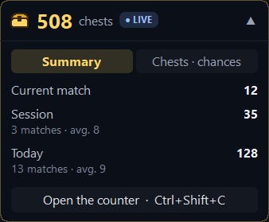
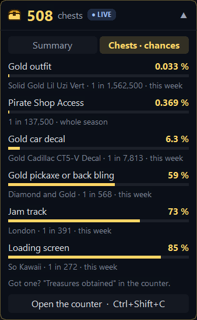
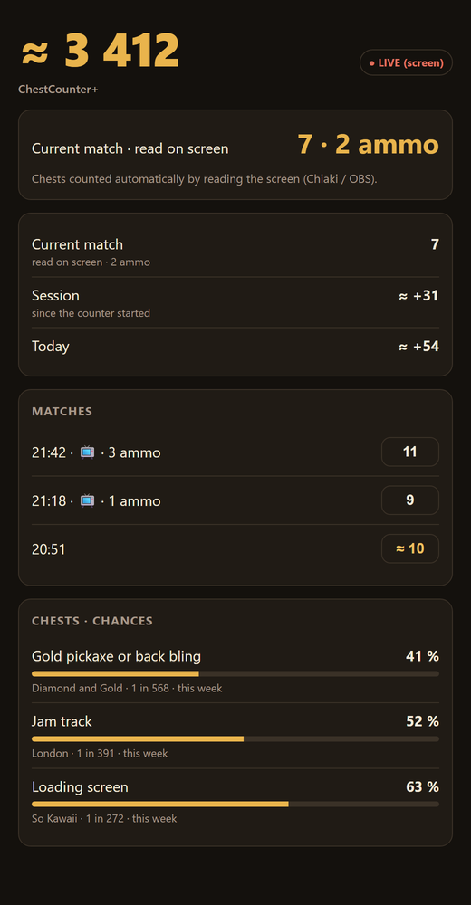
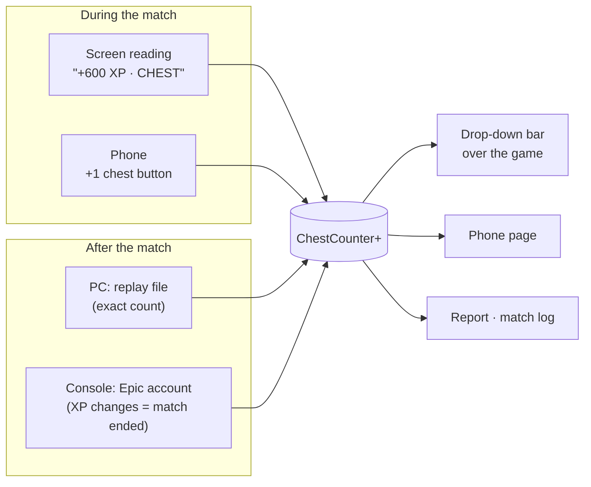
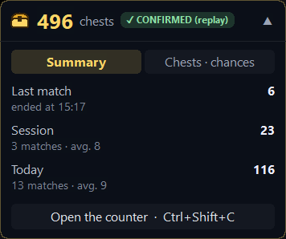
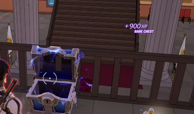
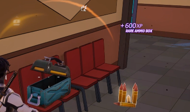

<div align="center">


# ChestCounter+

**A Fortnite chest counter for PC _and_ console: live chest count, a drop-down overlay, treasure odds, and a phone companion.**

   [](LICENSE)

&nbsp;&nbsp;&nbsp;&nbsp;

</div>

---

> [!NOTE]
> **ChestCounter+ is built on [Fortnite Chest Counter by LED-N](https://github.com/LED-N/Fortnite-ChestCounter)** (MIT license, version 1.4.0).
> All of the PC replay analysis, the report and the original overlay come from LED-N's work. ChestCounter+ adds console
> support, live counting, the drop-down bar, treasure odds and a phone page on top of it. Thank you LED-N!
>
> ChestCounter+ is a separate app (`ChestCounterPlus.exe`, its own data folder): it can live next to LED-N's version
> and imports its history on first launch. It is **not** affiliated with LED-N or Epic Games.

## Contents

- [What it does](#what-it-does)
- [How it counts](#how-it-counts)
- [Features](#features)
  - [The chest bar (overlay)](#the-chest-bar-overlay)
  - [Live counting by reading the screen](#live-counting-by-reading-the-screen)
  - [Console mode (PS5, Xbox, Switch)](#console-mode-ps5-xbox-switch)
  - [Treasure odds](#treasure-odds)
  - [Phone companion](#phone-companion)
  - [Match log](#match-log)
  - [Game modes](#game-modes)
- [Install](#install)
- [Keyboard shortcuts](#keyboard-shortcuts)
- [Settings](#settings)
- [Is it safe?](#is-it-safe)
- [Your data](#your-data)
- [Build from source](#build-from-source)
- [Limits](#limits)
- [Credits and license](#credits-and-license)

## What it does

ChestCounter+ keeps count of every chest you open in Fortnite: in the current match, this session, today and since you
started. A small bar sits over the game like the rest of the HUD, and drops down to show your figures and your chances
of having found this week's treasures.

| | PC | Console (PS5, Xbox, Switch) |
|---|---|---|
| **Live, during the match** | Reads the `+XP` shown on screen (Fortnite window) | Reads the `+XP` shown on screen (Chiaki or OBS window) |
| **Confirmed, after the match** | Fortnite replay files (exact) | Epic account: exact up to 1,000 chests, then your answer or an estimate |
| **Session** | From Fortnite launch to close | From counter start to stop |
| **Report and history** | ✅ | ✅ |

## How it counts



- **During the match**, Fortnite keeps the replay file locked and Epic's servers publish nothing, so the only live
  source is what the game shows on screen: every chest gives a `+XP` popup with its name under it.
- **After the match**, the count is confirmed: on PC by the replay file, on console by the Epic account (which also
  tells the counter that a match just ended).

## Features

### The chest bar (overlay)

A drop-down bar that stays on top of the game (Fortnite must be in *Windowed fullscreen*). Closed, it only shows your
total and a status badge; open it with **Ctrl+Shift+E** to see the **Summary** and **Chests · chances** tabs.


&nbsp;&nbsp;

| Badge | Meaning |
|---|---|
| `● LIVE` | Match in progress, chests counted live from the screen |
| `● MATCH IN PROGRESS` | Match in progress, no live figure (screen reading off) — the count comes at the end |
| `✓ CONFIRMED (replay)` | PC: exact figures from the replay files |
| `● LIVE (screen)` | Console: match in progress, read from the Chiaki / OBS window |
| `≈ ESTIMATE` | Console: estimated figures (beyond Epic's 1,000-chest cap) |
| `✓ CONFIRMED (Epic)` | Console: exact figures from the Epic account |

**Summary tab:** current match (or last match with its end time), session, today, with the number of matches and the
average. The **Open the counter** button (or **Ctrl+Shift+C**) brings the counter window back, even from the tray.
The classic card and the HUD styles of LED-N's overlay are still available in the settings.

### Live counting by reading the screen

Every time you open something, Fortnite shows a `+XP` popup with a label under it. ChestCounter+ reads that label with
the OCR built into Windows, two times per second:

&nbsp;&nbsp;

| Label on screen | Counted as |
|---|---|
| `CHEST`, `COFFRE` | chest |
| `RARE CHEST` | rare chest (counts as a chest too) |
| `AMMO BOX`, `RARE AMMO BOX` | ammo box (counted apart, not a chest) |
| `ELIMINATION`, `HEADSHOT`, `NEW STORM PHASE`… | logged in the match log only |

How it works, in short:

1. **Capture** the game window (`PrintWindow`), so it works **even behind other windows** — only minimizing it stops it.
2. **Crop** the game picture (black bars of Chiaki / OBS removed) to the area where the popup appears, upscale it ×3.
3. **Read** it with `Windows.Media.Ocr` and match `+N XP` with the label just under it. OCR mistakes such as
   `RARE CREST` or `AMMO gox` are tolerated.
4. **De-duplicate**: one popup stays on screen ~2 s and is seen on several frames; it counts once.
5. **Lobby check** every 4 s: the top menu (`PLAY · SHOP · LOCKER…`) means you are not in a match.

Where to read:

- **PC**: the Fortnite window, nothing to set up.
- **PS5**: [chiaki-ng](https://github.com/streetpea/chiaki-ng) (free Remote Play client for PC) or OBS (capture card).
  Make the window as big as you can (1080p reads best).

### Console mode (PS5, Xbox, Switch)

Console replays never leave the console, so ChestCounter+ reads your **Epic account** instead (one-time sign-in,
read-only):

- **Chest counter**: the *Treasure Hunt* quest counts your chests, but stops at **1,000**.
- **Beyond 1,000**: an estimate = your chests per match × the matches Epic reports per day. Calibrate it once with your
  real numbers (matches and chests of the season) for a better estimate.
- **End of match**: Epic updates your XP only when a match ends (tested: nothing during the match, everything a few
  seconds after leaving). The counter sees it and closes the match with, in this order:
  1. your answer (*How many chests?* on the phone or in the counter),
  2. the chests read on screen (Chiaki / OBS),
  3. your taps on the phone's **+1 chest** button,
  4. otherwise your average, marked `≈`.

### Treasure odds

The **Chests · chances** tab shows, for each treasure of the week, your chance of having found it with the chests you
opened: `1 − (1 − 1/N)^chests`, using the odds published for the season (gold outfit, pirate shop access, gold car
decal, gold pickaxe or back bling, jam track, loading screen). Weekly treasures reset on Sunday at 14:00 UTC; pirate shop
access counts for the whole season.


Already got one? Tick it in **Treasures obtained** (in the counter) and it leaves the list. On PC, a treasure found in a
replay is ticked automatically.

### Phone companion

Menu **Phone (QR code)**: the PC serves a small page on your local network. Scan the QR code with the phone's camera,
then *Add to Home screen* to keep it like an app.

> [!IMPORTANT]
> - The phone must be on the **same Wi-Fi** as the PC (not on 4G/5G, not on a guest Wi-Fi).
> - The first time, Windows shows a **Windows Firewall** prompt for ChestCounter+: tick **Private networks** and click
>   **Allow**. Without it, the phone cannot reach the PC.
> - Still not loading? Windows is blocking the phone (Wi-Fi set to *Public*, or permission refused). Open PowerShell
>   **as administrator** and run once:
>   ```powershell
>   Get-NetConnectionProfile | Set-NetConnectionProfile -NetworkCategory Private
>   New-NetFirewallRule -DisplayName "ChestCounter+ (telephone)" -Direction Inbound -Protocol TCP -LocalPort 8723 -Action Allow -Profile Private
>   ```
>   The first line sets your home Wi-Fi to private; the second only opens the phone's port, on private networks only.


- Your bar (total, current match, session, today, chances), refreshed every 3 s.
- Console: **+1 chest** button during the match (when the screen is not read), *How many chests?* after a match, and
  your last matches to correct (or delete with *not a match*).
- The link holds a secret key; without it the page answers 403. Nothing leaves your network and the Epic sign-in is
  never served.

### Match log

Menu **Match log (today)**: one line per `+XP` read on screen, with the time, plus the start of each match (with its
mode) and the return to the lobby.

```text
14:20:12  ── match started (Battle Royale)
14:20:46  +600 XP · CHEST  →  chest
14:20:52  +600 XP · NEW STORM PHASE  →  other
14:21:14  +1700 XP · HEADSHOT  →  other
14:23:19  +300 XP · AMMO BOX  →  ammo
14:23:30  +600 XP · CHEST  →  chest
14:47:07  ── back to the lobby
```

### Game modes

The mode is read on the lobby card (`BATTLE ROYALE`, `RELOAD`, `LEGO`…) before each match. By default **only Battle
Royale is counted live**; *Settings → Modes counted live* switches to *Battle Royale + Reload* or *all modes*. If the
mode could not be read, the match is counted (better than missing it) and the log says so.

## Install

1. Download the `ChestCounterPlus` folder and put it somewhere that stays (for example `C:\ChestCounterPlus`, not
   *Downloads*).
2. Double-click **`Lancer ChestCounter+.bat`** (or `ChestCounterPlus.exe`). Windows may warn that the app is not signed:
   *More info → Run anyway*.
3. First launch: choose your language (English, French, Spanish) and your platform (PC or Console).
   - Had LED-N's Chest Counter? Its history is copied automatically. `Desinstaller ChestCounter LED-N.bat` removes the
     old app afterwards (it never touches ChestCounter+).
4. **PC**: turn replays on in Fortnite (*Settings → Game → Replays → Record Replays: On*) and use *Windowed fullscreen*.
   **Console**: *Sign in to Epic* once; open Chiaki or OBS for live counting.
5. Optional: *Settings → Open with Fortnite* starts the counter by itself when the game starts.

## Keyboard shortcuts

They work everywhere, even in game.

| Shortcut | Action |
|---|---|
| **Ctrl+Shift+E** | Open the bar, then next tab (Summary → Chests · chances → closed) |
| **Ctrl+Shift+O** | Show / hide the bar |
| **Ctrl+Shift+L** | Lock / unlock the bar (unlocked: drag it, click its tabs and buttons) |
| **Ctrl+Shift+C** | Bring the counter window back |

## Settings

| Setting | Values |
|---|---|
| Platform | PC (replays) · Console (Epic account) |
| Screen reading | auto (PC → Fortnite, console → Chiaki) · Fortnite · Chiaki · OBS · off |
| Modes counted live | Battle Royale only · Battle Royale + Reload · all modes |
| Overlay | on / off, style (bar, HUD, classic), size, opacity, position |
| Open with Fortnite | starts the counter when Fortnite starts (Windows *Run* key) |
| Language | English · Français · Español |

## Is it safe?

- **No game modification**: nothing in the Fortnite install folder is touched; replay files are opened read-only.
- **No memory reading, no injection**: screen reading copies the window's picture like a streaming app (OBS) does.
- **Epic account**: read-only device sign-in, used for the Treasure Hunt quest, XP and match stats. You can sign out
  (and revoke it) from the counter at any time.
- No anti-cheat-sensitive technique is used, but this is a third-party tool: use it at your own risk.

## Your data

Everything stays on your PC, in `%APPDATA%\ChestCounterPlus`:

| File | Content |
|---|---|
| `data.json`, `config.json` | PC matches and settings |
| `ps5\` | console mode: `auth.json` (**your Epic sign-in, never share it**), `data.json`, report |
| `journal\` | match logs, one file per day |
| `treasures.json` | treasures you ticked |
| `report.html` | detailed report (opened from the counter) |

## Build from source

Requires the .NET 10 SDK. Builds a single self-contained Windows exe (works from WSL too):

```bash
dotnet publish src/ChestCounter/ChestCounter.csproj -c Release -r win-x64 --self-contained true \
  -p:PublishSingleFile=true -p:IncludeNativeLibrariesForSelfExtract=true -p:EnableCompressionInSingleFile=true \
  -p:DebugType=none -o dist
dotnet test tests/ChestCounter.Tests        # unit tests (xUnit)
```

Project layout (main files added by ChestCounter+):

| File | Role |
|---|---|
| `Ps5Mode.cs` | console mode: Epic sign-in, Treasure Hunt counter, estimate, end-of-match detection |
| `ConsoleMatches.cs` | console matches: XP-based end of match, answers, screen counts, averages |
| `LiveScreen.cs`, `ScreenOcr.cs`, `XpPopup.cs` | screen reading: capture, OCR, `+XP` popup parsing, lobby and mode |
| `BarModel.cs`, `NativeOverlay.cs` | the drop-down bar (Win32 / GDI) |
| `TreasureOdds.cs`, `ObtainedStore.cs`, `Assets/treasures.json` | treasure odds and ticked treasures |
| `PhoneServer.cs`, `Assets/phone.html` | phone page (local HTTP server, QR code) |
| `Sessions.cs` | session and day windows |

Diagnostic tools: `--ps5-xp [minutes]` (logs XP / quest changes), `--ps5-stats`, `--ps5-quests`,
`--ocr-test [minutes] [window]` (logs what the screen reader sees), `--ocr-file <png>…` (reads screenshots offline).

## Limits

- Live counting needs the `+XP` popup to be visible: if you hide the HUD or the window is minimized, nothing is read.
- OCR can miss a popup now and then (small window, busy background). The replay (PC) or your answer (console) is what
  confirms the final count.
- Console beyond 1,000 chests: without screen reading or your answers, figures are estimates (`≈`). Epic publishes daily
  match counts only the next day.
- Treasure odds come from a frozen copy of the season data; they are not downloaded.
- The `+XP` labels are checked live in English. French, Spanish, German, Italian, Portuguese, Polish and Turkish
  keywords are included but not yet confirmed in a real match; languages with other alphabets (Russian, Japanese…) are
  not read.

## Credits and license

- **[LED-N / Fortnite-ChestCounter](https://github.com/LED-N/Fortnite-ChestCounter)** — the original app this is built
  on: replay analysis, report, overlay, installer logic (MIT). The season odds in `Assets/treasures.json` are a copy of
  its 1.5.0 content (MIT). LED-N's original READMEs are kept in [`docs/upstream`](docs/upstream).
- [FortniteReplayDecompressor](https://github.com/Shiqan/FortniteReplayDecompressor) by Shiqan — replay parsing (MIT,
  in `lib/`, changes listed in [`lib/PATCHES.md`](lib/PATCHES.md)); OozSharp (Ooz by powzix, converted by SL-x-TnT).
- [QRCoder](https://github.com/codebude/QRCoder) — QR code of the phone link (MIT).
- [Pirata One](https://fonts.google.com/specimen/Pirata+One) — report headings font (SIL Open Font License).
- [chiaki-ng](https://github.com/streetpea/chiaki-ng) — not bundled; recommended to read a PS5 on the PC.

Released under the [MIT license](LICENSE), like the original. Fortnite is a trademark of Epic Games; this project is not
affiliated with or endorsed by Epic Games.
